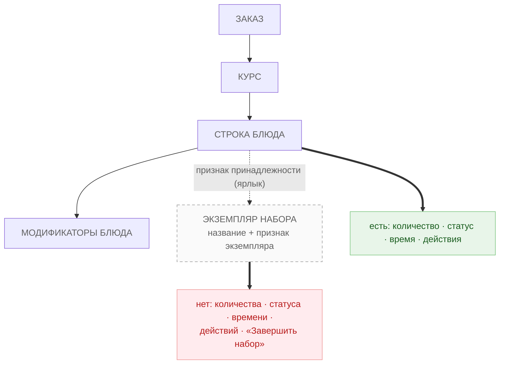
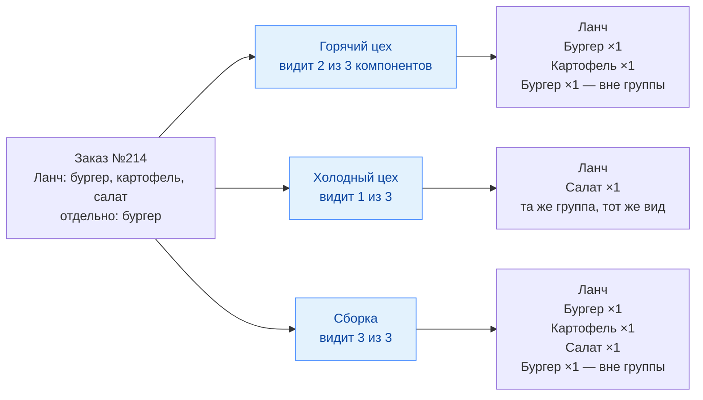
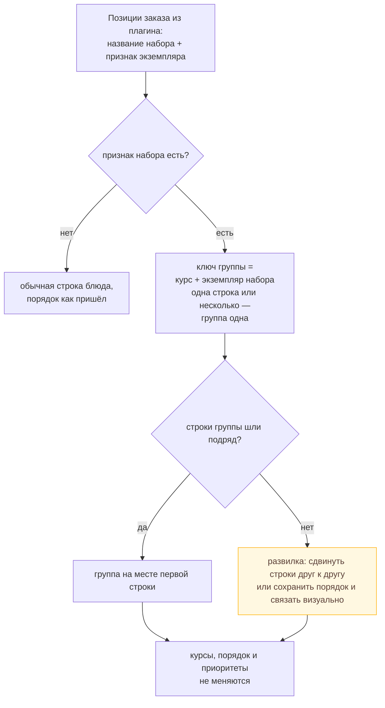
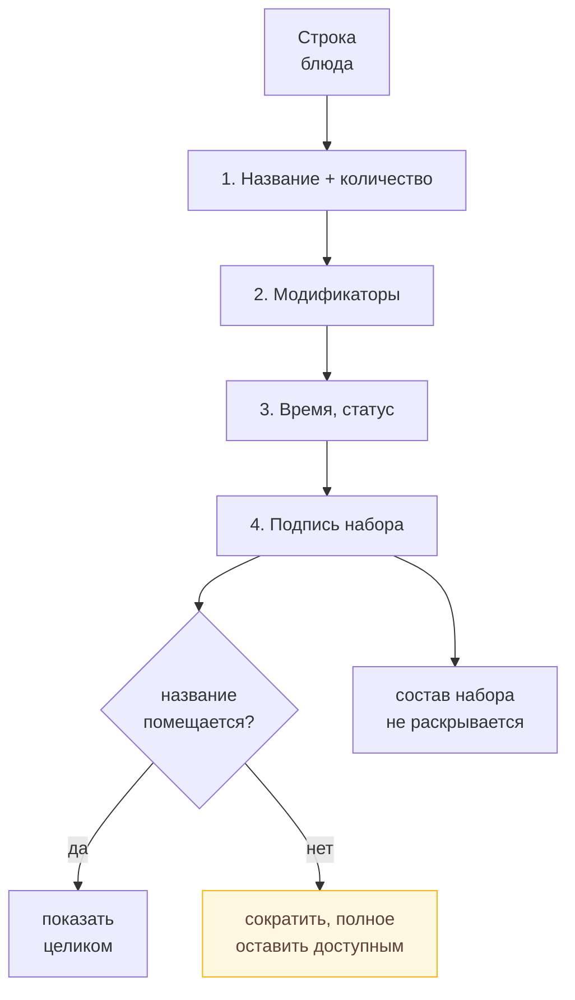
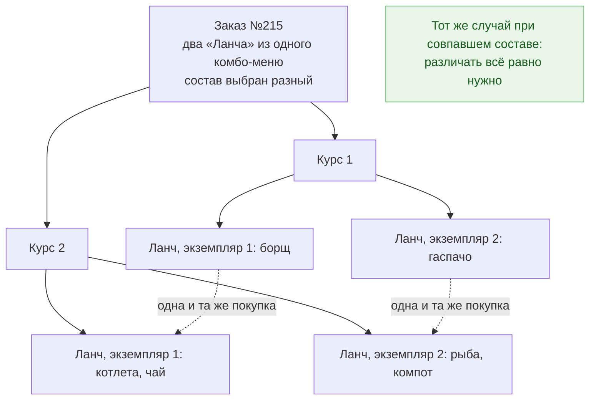
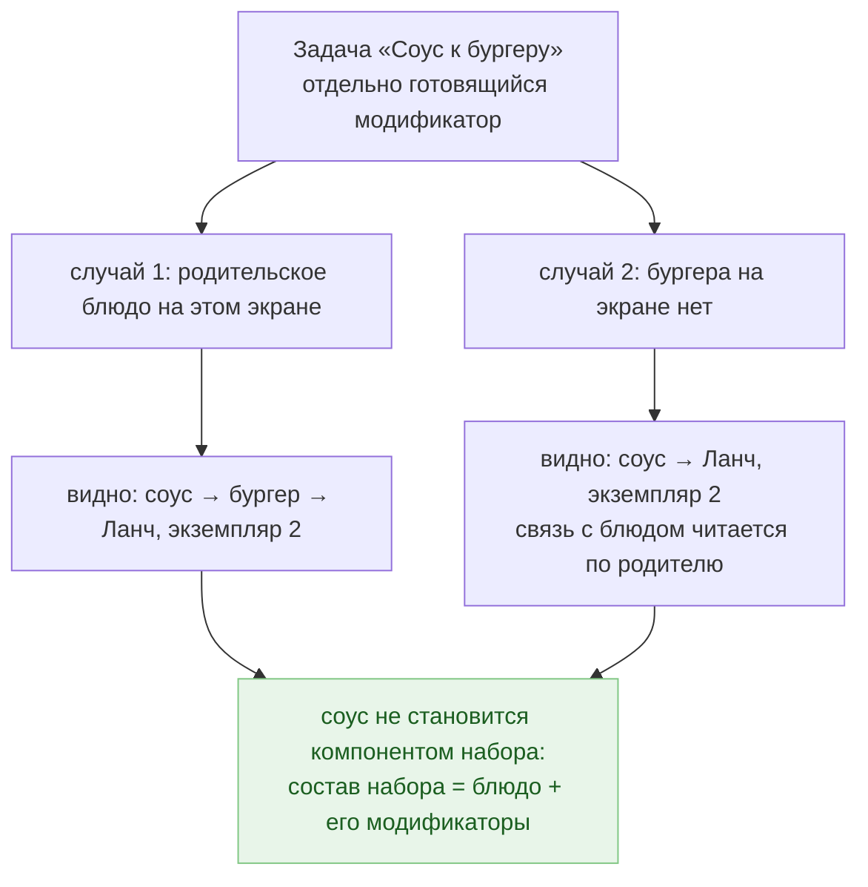

# PB-8108 · Комбо-набор на кухонном экране

Блок-схемы к задаче на дизайн. Только то, что есть в задаче и сценариях; спорное помечено как решение дизайнера.

Источник: Jira PB-8108, родительская PB-8101, вложение «Пользовательские сценарии работы с комбо» (PB-7812, ред. 19.10.2026).

## Как читать

Каждая схема отвечает на один вопрос. Синие блоки — экраны, зелёные — правило, что есть, красные — чего нет, пунктир — связь-ярлык, а не исполняемый элемент. Жёлтым помечены места, где задача оставляет решение дизайнеру.

## 1. Карта сущностей и границ

**Вопрос:** Что на экране исполняемый объект, а что только ярлык?

**Что из этого следует:**

- Всё исполняемое живёт у строки блюда: количество, статус, время, действия. Набор ничего из этого не отменяет и не дублирует.
- Экземпляр набора — атрибут блюда (название + признак экземпляра), а не отдельная строка списка.
- Модификатор принадлежит блюду. Поэтому компонент набора — блюдо вместе с его модификаторами.
- Заголовок группы набора существует только как оформление списка и не участвует в статусах.

## 2. Один заказ на разных экранах

**Вопрос:** Почему один и тот же заказ выглядит по-разному и это норма?

**Что из этого следует:**

- Способ обозначения группы один и тот же на всех экранах: меняется только число строк внутри.
- Группа с единственной видимой строкой — норма, а не особый случай: холодный цех видит салат так же, как сборка видит три компонента.
- Отдельно купленный бургер остаётся вне группы. Чужие позиции не подтягиваются в группу ради полноты.
- Экран цеха не должен давать повода думать, что показан весь состав набора или что набор готов.

> Открытое решение: Как именно оформляется заголовок, чтобы он читался как группа, а не как исполняемая строка (открытый вопрос №1 задачи).

## 3. Сборка режима «по заказам»

**Вопрос:** Как из плоского списка позиций получается группа набора?

**Что из этого следует:**

- Ключ группы — пара «курс + экземпляр набора». Один и тот же набор в разных курсах даёт две разные группы, и они не склеиваются через границу курса.
- Группировка не меняет курсы, сортировку и производственные приоритеты. Меняется только подача внутри курса.
- Отменённый компонент не показывается как необходимая часть комплекта.
- Фильтр по цеху или статусу убирает строки, но не меняет способ показа: группа остаётся группой.

> Открытое решение: Если самостоятельно заказанное блюдо стоит между компонентами набора: сдвигать компоненты друг к другу (меняя порядок) или сохранять порядок и показывать принадлежность без перемещения. Задача требует «не вклиниваться» и одновременно «порядок сохраняется» — это решение дизайнера (открытый вопрос №3).

## 4. Строка блюда в режиме «по блюдам»

**Вопрос:** Что в строке и в каком порядке по важности?

**Что из этого следует:**

- Порядок считывания задаёт задача: сначала название и количество, статус, модификаторы и время; принадлежность к набору — дополнительный контекст.
- Остальные компоненты набора из строки не раскрываются: это подпись, а не раскрывающийся список.
- Пиктограмма набора — признак «входит в набор». Сама по себе она не различает разные экземпляры.
- Полное название доступно всегда, даже если в строке оно сокращено.

> Открытое решение: Как дать доступ к полному названию, не перегружая строку и не раскрывая состав (открытый вопрос №6).

## 5. Экземпляры одного набора

**Вопрос:** Как не перепутать две одинаковые покупки одного комбо?

**Что из этого следует:**

- Название набора экземпляр не идентифицирует: у двух покупок оно общее. Значит, нужен дополнительный признак экземпляра.
- Признак должен читаться и внутри курса, и между курсами: части одного комплекта не теряют связь после разделения по курсам.
- Количества и статусы порций двух экземпляров не смешиваются.
- Совпадение выбранного состава ничего не упрощает: два одинаковых набора — всё равно два комплекта.

> Открытое решение: Достаточно ли подписи с названием или нужен отдельный признак экземпляра, в том числе при совпавшем составе (открытый вопрос №4). От этого зависит вся разметка строки и заголовка.

## 6. Модификатор, который готовится отдельно

**Вопрос:** Как показать узел с двумя связями, не сделав его блюдом набора?

**Что из этого следует:**

- У отдельной задачи модификатора две связи: с родительским блюдом и с конкретным экземпляром набора этого блюда.
- Обе связи должны читаться и в случае, когда родительского блюда на экране нет.
- Состав набора от появления такой задачи не меняется: компонент набора — блюдо вместе с модификаторами.
- Свои статус и действия у задачи модификатора остаются по существующим правилам.

> Открытое решение: Как показать обе связи компактно, особенно когда виден только модификатор (открытый вопрос №7).

## Что дальше

1. Закрыть девять открытых вопросов: по каждому — вариант решения и его следствие для разметки.
2. На схемы наложить правила ДС: какие компоненты и токены отвечают за группу, заголовок, подпись и иконки.
3. Добавить матрицу состояний (частичная готовность, отмена, длинное название, узкий экран) и превратить всё это в ТЗ для отрисовки прототипов.

## Источники

- [PB-8108](https://jira.iiko.ru/browse/PB-8108)
- [PB-8101](https://jira.iiko.ru/browse/PB-8101)
- [PB-7812](https://jira.iiko.ru/browse/PB-7812)
- [DS-1577](https://jira.iiko.ru/browse/DS-1577)
